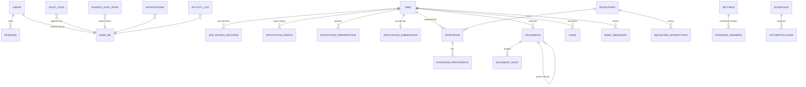

# Architecture

## Scope

Aira is a local-first AI Career Copilot layered beside the existing LinkedIn MCP server. It runs on one machine, binds to loopback only, stores data in per-account SQLite databases plus an encrypted document store, and uses a local Ollama model for generation. This document describes what is implemented today; `docs/implementation-plan.md` tracks status against `docs/requirements.md`.

## Stack

| Layer | Technology | Why |
|---|---|---|
| API and scheduler | Python 3.12+, `http.server` (threaded), stdlib `sqlite3` | The repository already used this stack; no framework migration was justified. |
| Domain modules | `aira/` package (pure functions, connection injection) | Testable in isolation; the server module only wires routes. |
| LinkedIn | Existing FastMCP + Patchright server, one isolated worker per account | Preserves the upstream integration unchanged. |
| SerpApi (Aira API and Careers) | `aira/airaapi/` (catalog of 136 engines, client, store, service, `/v1` compatibility layer, Careers) | One validated key, one recorded and cached call path for the console, Careers, the Jobs-tab Google source and scripts. `urllib` only. |
| ATS and Google Jobs | `linkedin_mcp_server/job_sources.py` (contracts, LinkedIn, Greenhouse, Google/SerpApi) and `aira/ats.py` (Lever, Ashby, SmartRecruiters, catalog, portal detection) | Official public APIs only, injected transports for tests. |
| UI | Static HTML/CSS/vanilla JS served by Aira (`auto_apply_assistant/`), hash router, no build step | Works offline, CSP `script-src 'self'`, no bundler to maintain. |
| AI | Ollama (`/api/chat`, JSON mode) | Local inference; nothing leaves the machine. |
| Encryption | `cryptography` Fernet for documents at rest | Vetted library; key file beside the database or `AIRA_DOCUMENT_KEY`. |

## Components

```mermaid
flowchart LR
    Browser[Dashboard SPA] -->|HTTP 127.0.0.1:8765| Server[auto_apply_assistant.py\nroute table + request context]
    Server --> Schema[aira.schema\nversioned migrations]
    Server --> Domain[aira.* domain modules]
    Domain --> Scoring[scoring / field_mapping / candidate]
    Domain --> Apps[applications / interviews / crm / audit]
    Domain --> Email[email_intel]
    Domain --> Docs[documents (Fernet)]
    Domain --> Analytics[analytics]
    Server --> Sources[job_sources + aira.ats adapters]
    Sources --> LinkedInWorker[Per-account LinkedIn MCP worker]
    Sources --> ATS[Greenhouse / Lever / Ashby / SmartRecruiters public APIs]
    Sources --> Serp[SerpApi google_jobs]
    Server --> AiraApi[aira.airaapi
service + store + client]
    AiraApi --> Serp2[SerpApi engines]
    Scripts[Your scripts] -->|/v1 + Aira API key| Server
    Sources -->|Jobs-tab Google source| AiraApi
    Server --> Ollama[Ollama]
    Server --> SQLite[(accounts.sqlite3 + per-user DB)]
    Docs --> Blobs[(encrypted blobs)]
```

### Server (`auto_apply_assistant.py`)

- **Route table**: handlers are registered with `@route(method, pattern, auth=True)`. `_dispatch` assigns a correlation ID (`X-Request-ID`), enforces the per-client rate limit, checks same-origin for mutations, authenticates the session cookie, parses JSON, maps exceptions to error envelopes (`400` ValueError, `404` LookupError, `403` PermissionError, `502` RuntimeError, `500` otherwise), records metrics, and clears request-local context.
- **Request context** (`threading.local`): data path, user ID, LinkedIn worker port, actor email, correlation ID, and source (`user` or `schedule`).
- **Services**: thin database-bound wrappers (`_query_jobs`, `_score_job_record`, `_unified_search`, `_import_job_from_url`, `_prepare_application`, `_submit_application`, `_import_email`, `_apply_email_action`, `_dashboard`, `_export_account`, `_delete_account`) that call `aira.*` with an explicit connection.
- **Scheduler**: unchanged in-process loop that runs LinkedIn job/inbox schedules per connected account with backoff.

### Domain modules (`aira/`)

| Module | Responsibility |
|---|---|
| `schema` | Migration ledger (`schema_migrations`), thirteen additive migrations (12 `airaapi`, 13 `careers`), `describe()` for docs. |
| `candidate` | Universal candidate profile fields with sensitivity, validation, completeness, scoring-profile projection, standard answers. |
| `scoring` | `explainable-match-v2`: ten evidence-only dimensions, configurable weights, classification, skill lexicon, section-aware skill extraction, hard blockers for explicit sponsorship conflicts. Reuses `matching.score_keyword_evidence` for resume coverage. |
| `field_mapping` | 42 canonical ATS fields with synonyms, sensitivity, confirmation rules; label mapping with confidence; prefill that never fills sensitive answers without explicit confirmation. |
| `ats` | Lever, Ashby, SmartRecruiters adapters; shared retrying transport; `SOURCE_CATALOG` (available vs planned with reasons); portal URL detection; single-posting import; Greenhouse application questions. |
| `applications` | Packet building, review, approval, submission records with idempotency keys, queue, daily limit, auto-submit policy (disabled). |
| `email_intel` | Rule-based classification (nine categories), explicit extraction (dates with time zones, links, deadlines, IDs, contacts), `.eml` parsing, fingerprints, suggested actions with confirmation gates. |
| `interviews` | Interview CRUD, participants, reminders/tasks, duplicate guard, calendar UID/sequence management. |
| `calendar_sync` | RFC 5545 ICS generation (TZID, VALARM, METHOD:CANCEL), Google/Outlook/Office 365 links, fingerprints, reschedule/cancel helpers. |
| `crm` | Recruiters, interactions, follow-ups, conservative dedupe. |
| `inbox_store` | Local cache of LinkedIn conversations (threads, messages, sync-run ledger), inbox-list text parsing, LinkedIn date-label resolution. The Messages tab reads only from it; a background sync fills it. |
| `documents` | Encrypted versioned document store with validation, scan hook, audit, retention, owner isolation. |
| `audit` | Append-only audit log, notifications, tasks. |
| `analytics` | Aggregates with metric definitions, period/source/status filters, null-safe rates, timeline. |
| `observability` | JSON/text logging with redaction, correlation IDs, in-process metrics. |
| `airaapi` | See below: SerpApi catalog, client, store, service, `/v1` compatibility layer and Careers. |
| `security` | Security headers, sliding-window rate limiter, same-origin and custom-header CSRF checks. |

### Aira API and Careers (`aira/airaapi/`)

The design contract is `docs/airaapi-spec.md`; this is the map.

| Module | Responsibility |
|---|---|
| `catalog` + `catalog/*.json` | The 136 engines and `platform.json` (plans, errors, dashboard pages). Validates parameters and prices a search (`credit_cost`). Shipped as package data. |
| `client` | `SerpApiClient` over `urllib`: one retry on network errors and 5xx, never on 4xx, redirects refused, the key scrubbed from every error and body. Base URL overridable with `AIRA_SERPAPI_BASE_URL`. |
| `store` | Tables from migration 12 (`airaapi_searches`, `_saved`, `_monitors`, `_usage`, `_secrets`, `_api_keys`, `_cache`), zlib-compressed result bodies, retention and size caps, the Fernet `SecretStore` for the pasted key. |
| `service` | `run_search` (validate, serve a fresh identical run from cache for 0 credits, apply the local hourly cap and concurrency cap of 4, call SerpApi, record errors too), async polling, history, diff, exports, saved searches, monitors with a hook list, usage rollups, account and locations caches. |
| `compat` + `http` + `routes` | The `/v1/*` SerpApi-compatible API, a small route framework (`@aira_route`), and every `/api/airaapi/*` handler. The server installs them on the existing `RequestHandler` so CSRF, rate limiting and error envelopes stay in one place. |
| `careers`, `careers_intel`, `careers_routes` | Google Jobs normalization, duplicate-safe import through the normal importer and scorer, six report kinds (one recorded engine call per section, at most 4 at once), job alerts built on a saved search plus a monitor (migration 13). |

Front end: `views-serp-kit.js` (shared parameter forms, result renderers, snippets), `views-airaapi.js` (console tabs), `views-playground.js`, `views-careers.js`, and `views-widgets.js` (the two Dashboard widgets). `app.js` owns the navigation list, from which the sidebar, the phone bottom bar (four quick items, the rest behind More), the `g` then letter chords and the shortcuts help are all generated.

Key resolution has one owner (`service.resolve_key`): the account's own pasted key wins over `SERPAPI_API_KEY`. The Jobs-tab Google source, `/api/sources`, `/api/status`, Careers, the console, monitors and `/v1` all ask it, so connecting or removing a key changes every one of them at once.

### Source adapter contract

Every adapter declares `source_name`, `capabilities` (`JobSourceCapabilities`: search, import, normalize, resolve application link, read status, prepare, submit, capture confirmation, report health), `normalize(record) -> JobPosting`, and `search(query) -> JobSearchResult`. ATS adapters add `fetch_job` and `health()`. No adapter in this build declares `submit_application`; the catalog says so explicitly and the auto-submit policy stays disabled.

## Data model



Key properties:

- `jobs` is the canonical deduplicated record (unique `(source, external_id)`, canonical URL and fingerprint matching through `job_source_records`). It carries normalized fields (workplace, employment type, salary, seniority, dates, application method, Easy Apply flag), the persisted score explanation (`match_*`, `scored_at`, inputs fingerprint for recalculation), saved flag, notes, follow-up, applied timestamp, and soft-delete `archived_at`.
- `application_events` and `audit_logs` are append-only; events carry previous/new status, source, actor, reason, correlation ID.
- `application_submissions.idempotency_key` is unique, preventing duplicate submissions.
- `documents` stores metadata only; blobs live under `<data dir>/documents/<owner>/<id>.bin`, Fernet-encrypted, SHA-256 verified on read.
- Migrations are additive (`aira/schema.py`); the ledger is exposed at `GET /api/settings`.

## Request flows

1. **Discover**: `/api/jobs/search` or `/api/jobs/import` → adapter → `_upsert_job` (dedupe) → `_score_job_record` when a description exists → `source_sync_runs` row.
2. **Score**: `aira.scoring.score_job(profile, resume, job)`; the inputs fingerprint changes whenever the resume, relevant profile fields, or job text change, so scores recompute lazily or via `/api/jobs/rescore` (profile saves trigger a background rescore).
3. **Prepare**: profile completeness → portal questions (Greenhouse) or standard questions → `field_mapping.map_fields` + `prefill_fields` → packet persisted with review flags; drafts snapshotted as versioned documents.
4. **Review/approve**: user answers become `user_review` values (optionally remembered as standard answers); approval requires no required gaps, no pending sensitive answers, approved drafts for the current resume version; job moves to Ready to Apply.
5. **Apply/submit**: daily limit check → job moves to Applying → user submits on the provider site → confirmation recorded with encrypted evidence → Applied, follow-up task, notification, audit.
6. **Email → interview**: classification + extraction → suggested action → user confirms (or auto-apply when enabled, above threshold, and non-sensitive) → interview with calendar UID, prep/follow-up tasks, status advance through allowed transitions only.
7. **Research**: Careers or the console → `service.run_search` → cache (0 credits) or SerpApi → record in history with its source (`playground`, `careers`, `intel`, `monitor`, `api`, `rerun`) → usage rollup. A Jobs-tab Google search and a Careers search with the same parameters cost one call. Importing a result goes through the same importer and scorer as any other job and merges into an existing posting instead of duplicating it.
8. **Monitors and alerts**: `_scheduler_loop` calls `_run_due_airaapi_monitors()` every 15 seconds; each account with a key runs its due monitors on one worker. A changed result raises an in-app notification that links to the stored run; a job alert lists only postings not seen before (the first run records a baseline) and can import high-scoring ones, but never applies to anything.
9. **Your scripts**: `GET /v1/search.json?api_key=aira_...` → hash lookup in the accounts database → the owner's database and SerpApi key → the same `run_search` path → SerpApi's JSON plus `search_metadata.aira`.

## Boundaries and limitations

- Loopback only; no multi-tenant hosting, TLS, or reverse proxy contract.
- No candidate-side official submission API exists for the connected sources; submission is user-performed and recorded.
- SerpApi results are only as current and complete as SerpApi returns them; Aira never fabricates results, and without a key the console and Careers show a setup state. Outgoing webhooks and team seats are not built (see the coverage page in Aira API > Docs).
- Gmail/Outlook OAuth and Google/Microsoft calendar APIs are not connected; email is imported by paste/.eml and calendars via ICS/links.
- Workday, iCIMS, Taleo, Oracle, SuccessFactors, BambooHR, UKG, and direct career sites are catalogued as planned with reasons.
